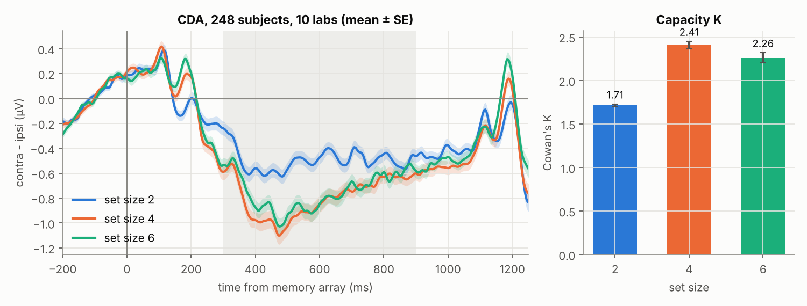
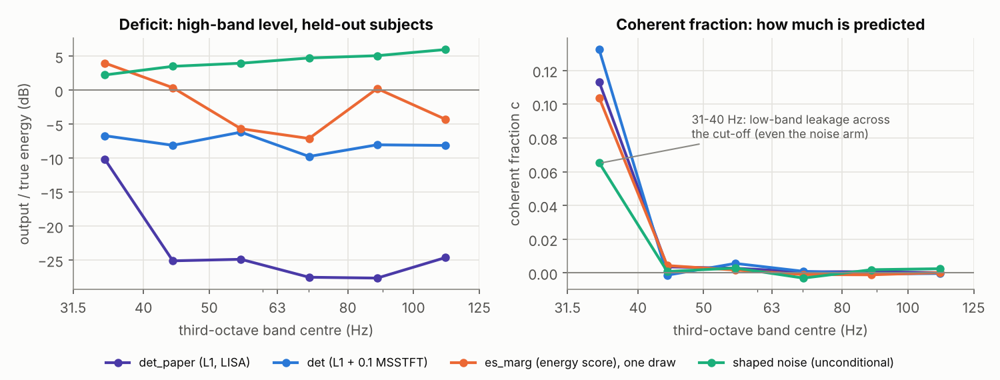
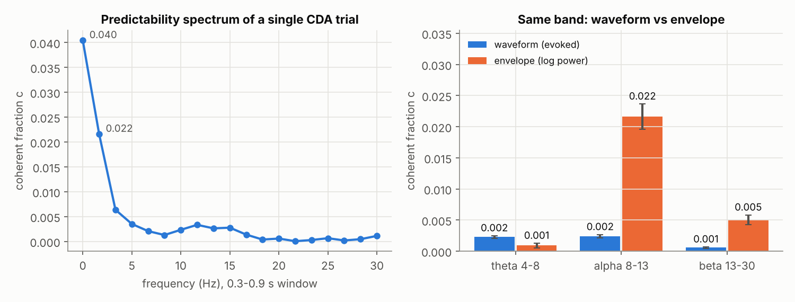
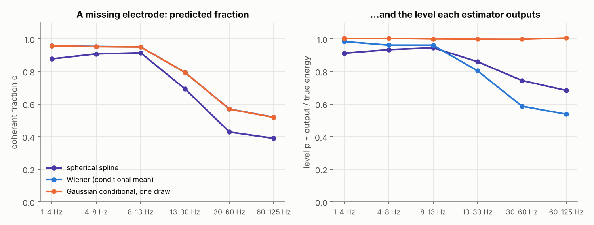
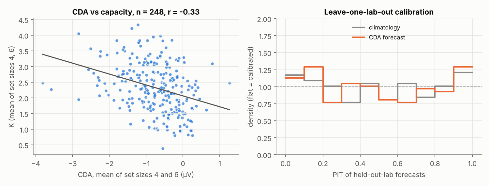

# lisa-rtm-eeg — do the lisa-rtm methods work on EEG?

Tested on the EEGManyLabs replication of Vogel & Machizawa (2004): **304 participants, ten labs, raw BIDS**
([GIN](https://gin.g-node.org/EEGManyLabs/EEGManyLabs_Replication_VogelMachizawa2004_Raw)). Every number below
comes from `src/` run on that data. Full tables: [`results/tables.md`](results/tables.md).

[lisa-rtm](https://github.com/Bromine185/lisa-rtm) has three layers:
- **The model.** LISA, the 88k local-implicit audio super-resolution network, and LISAS, the same network
  with noise channels trained under the energy score.
- **The diagnostics.** The identity `||y − w||² = E(1 + p − 2c)`, the coherent fraction `c`, the level `p`,
  `κ = c/p`, the SNR ceiling, the predictability spectrum, the gated deficit and the envelope regression.
- **The scoring.** Fair CRPS, PIT tails, and the gap read against its independent-draw value.

This repo asks of each layer whether it runs on EEG, whether it says anything true there, and whether that is
worth knowing.

## Verdict

| lisa-rtm piece | runs on EEG | what it found here | worth using on this dataset |
|---|---|---|---|
| **LISA / LISAS** as EEG bandwidth extension, 62.5 → 250 Hz | yes, unchanged: 87,777 parameters, 35 min on 4 CPU cores | the audio result again, nearly number for number: L1 leaves the band 23 dB short, the energy score closes it to −2 dB, `c ≤ 0.002` above 40 Hz for every model | **no.** The missing band (31–125 Hz) is muscle and gamma that the low band does not determine. A sampled gamma band is invented, not measured, and an ERP analysis discards that band anyway |
| **Coherent fraction, the identity, κ, the ceiling** | yes; the identity holds to 4e-16 | how much of a target is determined by a predictor: a CDA trial by its condition, a missing electrode by its neighbours, a missing band by the band below | **yes.** One scale for "evoked vs induced", "interpolable vs not", "predictable vs not" |
| **Predictability spectrum; waveform vs envelope** | yes | the CDA is the coherent part of a trial below 2 Hz (c = 4.3 %). Alpha's waveform is incoherent (0.24 %) but its lateralized **envelope** is 9× more predictable (2.16 %): the audio paper's "the band is noise, its envelope is not" | **yes.** It puts the CDA and alpha lateralization on one axis |
| **Sampler vs conditional mean** | yes, including a closed-form Gaussian sampler for a missing electrode | in space too, the MSE-optimal (Wiener) interpolator is muffled by exactly its coherent fraction (p ≈ c); one Gaussian draw has p = 1.00 in every band | sometimes. It matters wherever a missing high-frequency electrode or band feeds a power statistic |
| **Proper scores and reference forecasts** | yes | the CDA forecasts capacity K in an unseen lab with CRPS skill +5.8 % [2.2, 9.4]. Centring the CDA within lab removes it (+0.7 %); knowing only the lab is worth +15.8 % | **yes.** This is the most consequential result here. The CDA–K link is mostly between labs (r = −0.85, 10 labs), not between people (r = −0.19) |
| Gated deficit, envelope regression | yes | the sampler's envelope tracks the truth (r = 0.30 per draw, 0.60 at τ = 0) and is slightly compressed on loud frames | only for the BWE port |
| ViSQOL / PESQ / the LSD critique | no | these are perceptual audio metrics with no EEG counterpart | — |
| Transport ladder (T0–T4, S) | not run | superseded inside lisa-rtm itself | — |

**In one line:** the diagnostics and the scoring transfer and are worth using on this dataset. The network
transfers too, but here it solves a problem nobody has.

## The data, and the gate

| lab | n | rate (Hz) | EEG ch | reference | system | mains |
|---|---|---|---|---|---|---|
| Dartmouth | 28 | 500 | 32 | M2 | Brain Products | 60 |
| Florida | 50 | 500 | 129 | E129 | EGI | 60 |
| Mainz | 25 | 1000 | 60 | FCz | Brain Products | 50 |
| Münster | 30 | 1024 | 69 | CMS (none) | Biosemi | 50 |
| North Dakota | 28 | 250 | 66 | CMS (none) | Biosemi | 60 |
| Ohio | 24 | 1000 | 32 | Cz | Brain Products | 60 |
| Reykjavik | 30 | 1000 | 32 | Fz | Brain Products | 50 |
| Sheffield | 25 | 512 | 66 | CMS (none) | Biosemi | 50 |
| Zürich (Langer) | 40 | 500 | 125 | CPz | ANT Neuro | 50 |
| Zürich (Sauseng) | 24 | 1000 | 64 | FCz | Brain Products | 50 |

**Streaming, not downloading.** GIN serves no byte ranges, and the CDA recordings total ~150 GB. Every file is
BrainVision float32 in VECTORIZED order, one contiguous block per channel, so `src/prep.py` reads each file
off the socket channel by channel and keeps only two things. Nothing raw touches the disk.
- the lateral posterior pairs and an eye channel, epoched;
- a 180 s excerpt of every channel at 250 Hz.

**Gate.** Before any lisa-rtm method runs, the pipeline must show a CDA. The contralateral-minus-ipsilateral
difference cancels the recording reference, so the ten references do not matter.
- **Settings:** a 20 µV horizontal-eye step threshold on every eye channel, with F7 − F8 as a proxy in the four
  labs without EOG.
- **Exclusions:** subjects with < 50 % clean trials, accuracy < 0.6, or < 30 clean trials in any set size.
  That leaves 248 of 304.
- **Result:** CDA −0.50 / −0.79 / −0.75 µV at set sizes 2 / 4 / 6 (4 vs 2: t = −7.9). K = 1.71 / 2.41 / 2.26.
  The classic shape, rising to the capacity limit and flat beyond it, holds in eight labs. It is weak in
  Reykjavik and absent in Florida.



## 1. The model: LISA and LISAS as EEG bandwidth extension

Your architecture, losses and scorer, ported verbatim (`src/lisa_eeg.py`). Only the rates change:
- **Rates:** 62.5 → 250 Hz, R = 4 as in lisa-rtm.
- **The given band, 0–31.25 Hz,** is exactly what an ERP analysis keeps. The missing band, 31–125 Hz, holds
  5–14 % of the energy in nine labs and 42 % in one (Zürich-Sauseng has a flat noise floor).
- **Training:** 80 subjects (8 per lab), 48 h of single-channel recordings, three arms on identical batches,
  6,000 steps.
- **Scoring:** 30 unseen subjects (3 per lab) × 4 channels × 3 × 30 s, 8 draws per sampler. Line-noise bins are
  excluded from every high-band metric.

| condition | deficit dB | c > 40 Hz | SNR vs ceiling dB | CRPS | PIT low / high (ideal .111) | gap HB (indep.) dB |
|---|---|---|---|---|---|---|
| naive (polyphase sinc) | −51.1 | — | −0.11 | 6.59 | | |
| det_paper: L1 only (LISA's released loss) | **−23.3** | 0.002 | −0.12 | 2.90 | | |
| det: L1 + 0.1 MSSTFT | **−7.8** | 0.001 | −0.91 | 1.17 | | |
| es_marg at τ = 0 | −10.9 | 0.001 | −0.54 | 1.51 | | |
| es_marg, one draw | **−2.1** | 0.001 | −3.71 | **0.673** | 0.098 / **0.316** | 2.66 (2.91) |
| shaped noise, unconditional | +4.3 | 0.001 | −6.28 | 0.801 | 0.368 / 0.081 | 4.39 (4.38) |



Read against Tables 1 and 2 of your paper:
- **The audio pattern reproduces on a different signal.** L1 alone is muffled by 23 dB (audio: 21.8), the
  spectral term recovers most of that (−7.8; audio −6.2), and the energy score recovers the rest (−2.1;
  audio −0.7 to −1.05). CRPS falls 42 % from the point model to the sampler, the same as in audio
  (0.889 → 0.514). By your paper's own rule CRPS favours samplers by construction, so the fair comparison is
  the next point.
- **The band is incoherent.** Above 40 Hz `c` is 0.001–0.002 for every model; the 31–40 Hz band shows 0.07–0.13
  in every arm, including unconditional noise, which is low-band leakage across the cut. So the deterministic
  ceiling is the naive interpolator (det_paper sits 0.12 dB under it), and a level-correct band costs what the
  identity says: the sampler is 3.7 dB under the ceiling.
- **The sampler uses its input.** Among samplers, it beats unconditional shaped noise on CRPS (0.673 vs
  0.801), and it does
  that through the envelope: from the low band alone, the high-band frame envelope is predictable within a
  recording at r = 0.57, and the sampler tracks it (r = 0.60 at τ = 0, 0.30 per draw); shaped noise does not
  (r = 0.04).
- **The same residual bias.** The truth lies above all 8 draws in 32 % of high-band bins (ideal 11 %), while
  the lower tail is at its ideal (9.8 %). Your audio sampler showed the same pattern: a level bias, not a
  narrow ensemble. Its draws are nearly as diverse as their level allows (gap 2.66 dB vs 2.91 independent).
- **Why it is still not worth doing.** What the sampler restores is plausible muscle, not information about
  the brain. Temporal EEG super-resolution has a niche in low-rate wearables, but the band it would restore
  is the one every CDA/ERP pipeline low-passes away.

## 2. The diagnostics on the CDA itself: the CDA is a conditional mean

The trial-averaged CDA is, by construction, the minimiser of squared error for predicting a single trial's
lateralized signal from its condition. It is lisa-rtm's deterministic point model. Score it as one
(`src/cohere.py`): `w` = the leave-one-out mean of the trial's own set size, so a trial never predicts itself.

| on 248 subjects, 0.3–0.9 s | mean | median | t |
|---|---|---|---|
| c, broadband | 0.020 | 0.010 | 11.3 |
| c, 0–2 Hz / 2–4 / 4–8 / 8–13 / 13–30 Hz | 0.043 / 0.006 / 0.002 / 0.003 / 0.001 | | |
| alpha (8–13 Hz) **waveform** c | 0.0024 | 0.0011 | 8.4 |
| alpha **envelope** c (log power, contra − ipsi) | **0.0216** | 0.0091 | 10.6 |
| alpha lateralization, log contra/ipsi power | −0.085 | −0.071 | −13.7 |
| beta waveform / envelope c | 0.0006 / 0.0051 | | |



- **The CDA carries 2 % of the single-trial lateralized energy,** almost all below 4 Hz. That is the
  predictability spectrum of a sustained negativity. With c = 0.02, an M-trial average reaches signal = noise
  only at M = (1 − c)/c ≈ 50 trials.
- **In the alpha band the picture is the audio paper's:** the waveform is incoherent (what the ERP average
  sees is 0.24 %), but the envelope's lateralization is 9× more predictable. The averaged ERP is muffled
  exactly where working memory shows up as induced, not evoked, activity. A power-based readout recovers what
  the conditional mean discards.

This framing is the one genuinely new thing the methods add on this dataset. Evoked and induced
lateralization get one number on one scale.

## 3. The same identity in space: a missing electrode

Every labelled electrode of the 30 held-out subjects is predicted from all the others, scored per band
(`src/spatial.py`; each target is re-referenced to the mean of the *other* electrodes, otherwise a common
average makes it exactly predictable). Three estimators:
- **spline:** spherical spline, MNE's bad-channel repair, fixed by geometry;
- **Wiener:** the MSE-optimal linear map, fitted on the first 90 s, scored on the last 90 s;
- **Gaussian draw:** one draw from the exact Gaussian conditional.

| median of 30 | 1–4 | 4–8 | 8–13 | 13–30 | 30–60 | 60–125 Hz |
|---|---|---|---|---|---|---|
| Wiener c | 0.96 | 0.95 | 0.95 | 0.79 | 0.57 | 0.52 |
| Wiener p | 0.98 | 0.96 | 0.96 | 0.80 | **0.59** | **0.54** |
| Gaussian draw p | 1.00 | 1.00 | 1.00 | 1.00 | 1.00 | 1.01 |
| spline c / p | 0.88 / 0.91 | 0.91 / 0.93 | 0.91 / 0.95 | 0.69 / 0.86 | 0.43 / 0.75 | 0.39 / 0.68 |
| SNR dB: Wiener / draw / spline | 12.4 / 10.4 / 9.0 | 12.3 / 9.9 / 9.6 | 12.5 / 10.0 / 9.2 | 6.3 / 3.7 / 2.9 | 3.5 / 1.0 / 0.7 | 2.7 / 0.1 / 0.5 |



- **Below 13 Hz a missing electrode is 95 % coherent:** regression to the mean barely bites.
- **Above 30 Hz it is about half incoherent,** and the conditional mean is muffled by exactly that much
  (p ≈ c, as the lisa-rtm identity requires of the MSE optimum).
- **The Gaussian draw restores the level and pays the identity's price in SNR.**
- **The spline loses 2.2–3.4 dB to Wiener in every band,** and above 30 Hz κ falls to 0.57: almost half of
  its high-frequency output does not match the truth.

## 4. Proper scores for brain–behaviour: does the CDA predict capacity in a new lab?

Vogel & Machizawa's claim is that the CDA predicts an individual's capacity K. Score it as lisa-rtm scores a
sampler (`src/predict.py`): leave one lab out, fit on nine, and issue a Gaussian forecast of K for every
subject in the tenth. CRPS against two references:
- **climatology:** the nine labs' K distribution;
- **lab oracle:** the held-out lab's own mean K.

| feature (n = 248) | r | r within lab | CRPSS, CDA | CRPSS, CDA centred in lab | CRPSS, lab oracle | point sd / sd(K) |
|---|---|---|---|---|---|---|
| CDA, mean of set sizes 4 and 6 | −0.33 | −0.19 | **+5.8 %** [2.2, 9.4] | **+0.7 %** | **+15.8 %** | 0.33 |
| CDA, set size 4 | −0.28 | −0.15 | +4.2 % [1.0, 7.2] | +0.1 % | +15.8 % | 0.28 |
| CDA increase 2 → 4 (the original's predictor) | −0.23 | −0.11 | +2.6 % [−0.3, 5.6] | −0.4 % | +15.8 % | 0.23 |



- **The correlation is real, but it lives mostly between labs.** Lab mean CDA and lab mean K correlate at
  r = −0.85 across the ten labs; within a lab, r = −0.19.
- **Out-of-lab skill is mostly lab-level.** Knowing the lab is worth three times what the CDA adds, and once
  the lab-level part is removed, the CDA's skill is +0.7 %.
- **The original's difference score is the weakest predictor.** Its split-half reliability is 0.35, against
  0.83 for the set-size 4 amplitude, so it is the predictor least able to carry an individual difference.
- **Regression to the mean appears in its lisa-rtm form.** The point forecast's spread is |r| × sd(K), so it
  compresses the individual differences it was meant to measure. The probabilistic forecast stays calibrated
  (90 % intervals cover 90 %).
- **Robustness.** All of it holds after dropping the quarter of subjects with the largest residual
  lateralized eye signal (`results/strict_eye/`).

## Caveats

- **The pipeline is mine, not the replication team's.** ROI pooling, the eye criterion and the 0.3–0.9 s
  window are simple choices fixed in advance. Four labs use an F7 − F8 eye proxy. 18 % of subjects are
  excluded. Do not compare these CDA amplitudes with Strzelczyk et al.
- **BWE budget.** 6,000 steps on CPU, one seed, λ = 0.1 set by loss balance and not tuned (lisa-rtm: 105k steps
  on an A100). The sampler's residual level bias would likely shrink with budget; `c` would not.
- **Spatial.** Template 10-05 positions, not digitized ones. Wiener is fitted within a subject.
- **CDA → K.** Forecasts are Gaussian. The lab-level correlation rests on ten points.

## Reproduce

```bash
python3 -m venv venv && venv/bin/pip install numpy scipy pandas matplotlib mne torch
venv/bin/python -I src/survey.py data/meta                                   # sidecars only, ~1 min
venv/bin/python -I src/prep.py data/prep data/meta all --workers 6           # streams ~150 GB, keeps 8.8 GB, ~45 min
venv/bin/python -I src/cda.py data/prep data/meta results                    # the gate
venv/bin/python -I src/cohere.py data/prep results                           # section 2
venv/bin/python -I src/spatial.py data/prep data/meta results                # section 3
venv/bin/python -I src/predict.py results && venv/bin/python -I src/predict.py results --strict-eye   # section 4
venv/bin/python -I src/bwe.py train data/prep data/meta results/bwe --steps 6000                      # section 1, ~35 min CPU
venv/bin/python -I src/bwe.py score data/prep data/meta results/bwe
venv/bin/python -I src/figs.py results figs && venv/bin/python -I src/tables.py results data/meta > results/tables.md
```

## Files

```
src/survey.py      per-subject sidecar survey (rates, channels, references, filters)
src/prep.py        streaming BrainVision reader + CDA epochs + 250 Hz excerpts, round-robin over labs
src/splits.py      the one seeded subject ordering (BWE: 3 test + 8 train per lab)
src/cda.py         the gate: CDA by set size, Cowan's K, exclusions, split halves
src/lisa_eeg.py    LISA / LISAS, the arm losses and the metric code, ported from lisa-rtm
src/bwe.py         section 1: paired training, the score.py-style scorer, the shaped-noise control
src/cohere.py      section 2: coherent fraction of single CDA trials, waveform vs envelope
src/spatial.py     section 3: spline / Wiener / Gaussian draw for a missing electrode
src/predict.py     section 4: leave-one-lab-out CRPS, PIT, reliability
src/figs.py, src/tables.py   everything in this README, from results/
results/           per-subject tables, summaries, the three trained checkpoints (results/bwe/*.pt)
```

Data: EEGManyLabs, CC BY. Cite Strzelczyk et al. (2026, *Cortex*) and Vogel & Machizawa (2004, *Nature* 428,
748–751) when using it.
